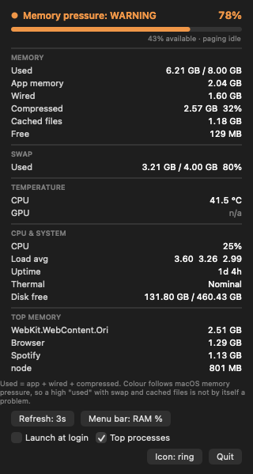
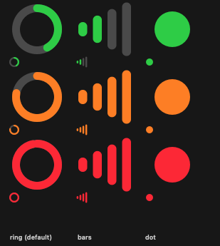

# SysMonBar

A small macOS menu bar system monitor. Memory pressure, CPU, temperature, swap,
disk and the hungriest processes — behind a coloured gauge sitting next to the
battery.

<p align="center">
  
</p>

The menu bar shows a live gauge whose colour is the current **memory pressure**:
green for normal, orange for warning, red for critical. Hover it (or click) for
the full panel above.

## Why another one

Most menu bar RAM widgets colour themselves by *occupancy*: "80% of RAM is full,
so that must be bad." On a Mac that is wrong. `.app` bytes, wired memory,
compressed memory and cached files all count towards "used", and macOS is
supposed to keep RAM full — a high "used" number with a healthy cache is the
system doing its job, not a problem.

SysMonBar colours by the kernel's own verdict instead:

- `kern.memorystatus_vm_pressure_level` — the same dispatch level Activity
  Monitor follows. 1 normal, 2 warning, 4 critical.
- `kern.memorystatus_level` — the kernel's own free-memory percentage, the
  number `memory_pressure` prints.
- Page-out rate, as an unambiguous thrashing signal.

Occupancy is still shown as a number, it just never decides the colour.

## Features

- **Live menu bar gauge** — colour = memory pressure, fill = RAM used.
- **Hover panel** — rest the pointer on the icon; it opens after a short dwell
  and closes when you move away.
- **Memory breakdown** — used / app / wired / compressed / cached / free, exactly
  the categories Activity Monitor uses.
- **Swap** — used out of total, plus live page-out rate.
- **CPU** — sampled from Mach host statistics, with load average.
- **Temperature** — per-core-cluster CPU and GPU where the hardware exposes it.
- **Top memory processes** — the four heaviest, sampled off the main thread.
- **Extras** — uptime, thermal state, free disk space.
- **Configurable** — three icon styles, three menu bar layouts, refresh interval
  from 1s to 10s, and a launch-at-login toggle.
- **No dependencies** — Swift + AppKit only. No Xcode project, no package
  manager, no Homebrew.

## Requirements

- macOS 13 (Ventura) or later
- Xcode Command Line Tools — `xcode-select --install`

Xcode.app is not required. Neither is Homebrew.

## Install

```bash
git clone https://github.com/ariefbudhima/menubar-sysmon.git
cd menubar-sysmon
./scripts/install.sh
```

That builds a release binary, packages it into `SysMon.app`, copies it to
`~/Applications`, and launches it. Look for the coloured ring in the menu bar,
next to the clock and battery.

Prefer just to build? The bundle lands in `dist/SysMon.app`:

```bash
./scripts/build.sh
```

### Why an `.app` bundle

The build script wraps the executable in a minimal bundle on purpose. The
`LSUIElement` key in `Info.plist` is what keeps the process out of the Dock and
out of the app switcher, and a bare executable cannot express that. The bundle
is also ad-hoc code-signed, which is enough for the system to trust it locally.

## Usage

Click the icon to toggle the panel, or hover it. The panel is laid out top to
bottom:

| Section | Contents |
| --- | --- |
| Header | Pressure level, RAM used, availability, paging rate |
| Memory | Used, app, wired, compressed, cached files, free |
| Swap | Used / total and percentage |
| Temperature | CPU and GPU, `n/a` when the hardware gives no reading |
| CPU & System | CPU %, load average, uptime, thermal state, disk free |
| Top memory | Four heaviest processes by memory footprint |

Buttons along the bottom:

- **Refresh** — cycle the sampling interval, 1s to 10s.
- **Menu bar** — cycle the menu bar layout: `RAM %`, `RAM + CPU`, `Icon only`.
- **Launch at login** — start SysMonBar when you log in.
- **Top processes** — turn the process scan off if you would rather it not walk
  the process table.
- **Icon** — cycle the indicator shape: `ring` (default), `bars`, `dot`.
- **Quit**

Preferences are stored in `UserDefaults`, so they survive a restart.

### Icon styles

Every style is drawn at three levels — normal, warning, critical — with the fill
showing RAM used. Top row is enlarged, bottom row is actual menu bar size:

<p align="center">
  
</p>

## Command line flags

The binary accepts a few flags that are useful when developing or when tuning
the readings against other tools.

```bash
# Render the panel and the icon grid to PNGs — no GUI session needed.
.build/release/SysMonBar --render-preview ./docs

# Print the sampler's CPU reading once a second, to line up against `top`.
.build/release/SysMonBar --cpu-probe 10

# Verbose hover/panel trace, plus a metrics dump, for debugging.
.build/release/SysMonBar --self-test
```

`--render-preview` is how the images in this README are generated, so they
cannot drift out of date with the drawing code.

## Uninstall

```bash
pkill -f "SysMon.app/Contents/MacOS/SysMon"
rm -rf ~/Applications/SysMon.app
```

If you enabled **Launch at login**, turn it off from the panel first. Otherwise
delete the leftover agent:

```bash
launchctl bootout gui/$(id -u)/com.arief.sysmonbar.loginitem
rm -f ~/Library/LaunchAgents/com.arief.sysmonbar.loginitem.plist
```

Preferences live under the `com.arief.sysmonbar` domain:

```bash
defaults delete com.arief.sysmonbar
```

## Architecture

```
Sources/SysMonBar/
├── main.swift           entry point, CLI flags
├── AppDelegate.swift    status item, timers, hover tracking, panel lifecycle
├── StatusIcon.swift     gauge drawing (ring / bars / dot)
├── Metrics.swift        Mach + sysctl sampling: memory, CPU, load, disk, procs
├── Temperature.swift    temperature via the HID sensor hub
├── DetailPanel.swift    the panel UI and its controls
├── PanelController.swift window that hosts the panel
├── LoginItem.swift      launch at login (SMAppService, LaunchAgent fallback)
├── Prefs.swift          UserDefaults-backed settings
└── Preview.swift        offscreen rendering used for the README images
```

A few decisions worth knowing about if you plan to hack on it:

- **The icon redraws only when the rendered result changes.** The gauge is about
  13pt across, so a whole percent is finer than the eye can resolve; skipping
  identical frames keeps idle CPU near zero.
- **The process scan is the only expensive part**, so it runs at a third of the
  panel's refresh rate, off the main thread, and only while the panel is open.
- **Hover uses cursor polling at 6 Hz**, not tracking areas, because the frame
  AppKit reports for a status item is unreliable once a second display is
  attached. The hit rects are rebuilt from the screen's real menu bar strip.

## Limitations

- **Temperature is read through a private API.** macOS has no public CPU/GPU
  temperature API, so this goes through the HID sensor hub, the same trick
  `asitop` uses. It works on Apple Silicon, it is not guaranteed to keep working
  across macOS releases, and it is expected to need updating eventually. When a
  reading is unavailable the panel simply shows `n/a`; everything else is
  unaffected.
- **Apple Silicon only, in practice.** GPU temperature is not in the SMC key
  space, and the classic Intel SMC keys do not resolve on Apple Silicon.
- **The app is ad-hoc signed.** Fine for running locally. If you distribute a
  build to other people, they will need to right-click → Open the first time, or
  you will need to sign and notarise it with a Developer ID.

## License

MIT — see [LICENSE](LICENSE).
